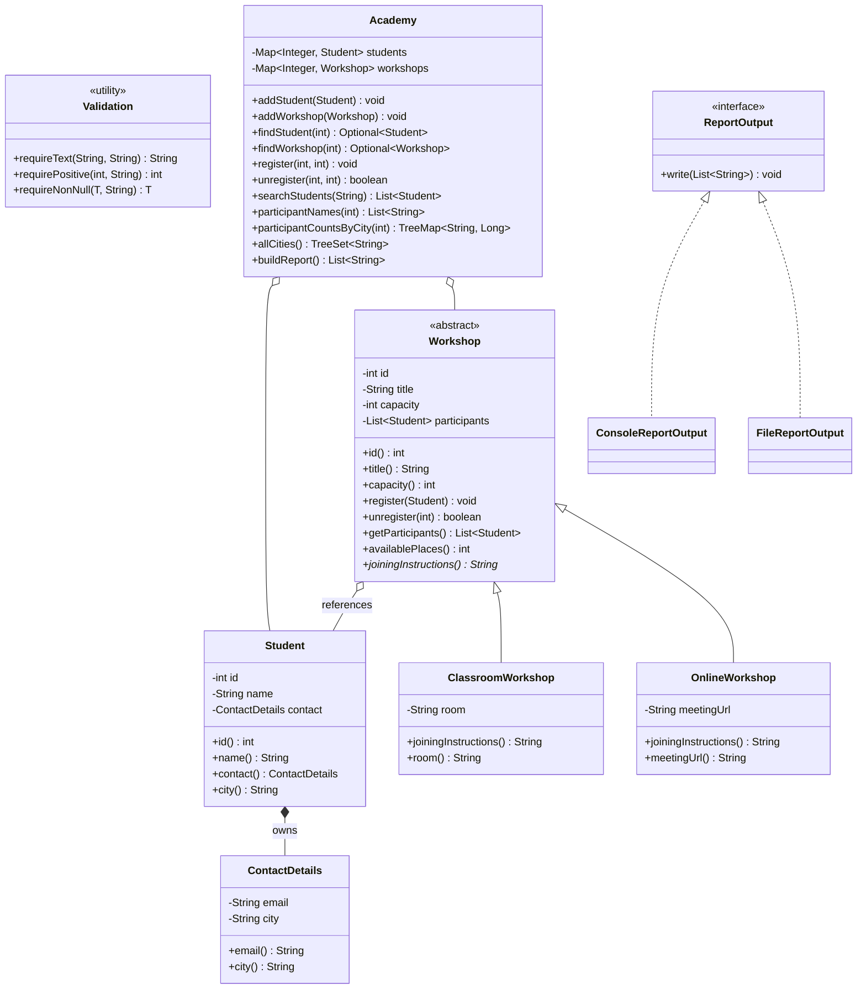

# Academy Workshop Manager — план реализации

> [!tip] Как пользоваться этим файлом в Obsidian
> 1. Иди строго по шагам.
> 2. Отмечай чекбоксы после каждого зелёного `mvn test`.
> 3. Не переходи к следующему шагу, пока предыдущий не компилируется и тесты не зелёные.
> 4. Файловый ввод-вывод — только после того, как ядро и дизайн обсуждены.

> [!info] Порядок по Боре
> Сначала дизайн и обсуждение, потом код по дизайну.
> Файловый ввод-вывод оставить на потом.
> Код должен быть читаемым, поддерживаемым и тестируемым.
> Нужно сравнить свой первый эскиз с предложенным дизайном и понимать, почему появились `ContactDetails`, `List<Student>`, `Academy`, `ReportOutput`.

---

## Чеклист

- [x] 0. Дизайн своими словами, письменно, до кода
- [ ] 1. `Validation`, `ContactDetails`, `Student` + тесты
- [ ] 2. `Workshop`, `ClassroomWorkshop`, `OnlineWorkshop` + тесты
- [ ] 3. `Academy`: add / find / register / unregister + тесты
- [ ] 4. `Academy`: отчёты на стримах + тесты
- [ ] 5. `ReportOutput`, `ConsoleReportOutput`, `Main`-демо без файлов
- [ ] 6. Файлы позже: `SimpleFiles`, `StudentFileLoader`, `FileReportOutput`
- [ ] 7. Расширения: `equals`/`hashCode`, меню, база данных

> [!note] Коммиты
> Коммит после каждого шага.
> Несколько маленьких зелёных коммитов лучше одного большого «вроде работает».

---

## 0. Дизайн до кода

### Главный смысл модели

1. `Student` владеет `ContactDetails`.
   Это композиция: контакты не живут отдельно от студента.

2. `Workshop` только ссылается на студентов.
   Это ассоциация: отмена регистрации удаляет ссылку из списка участников, но не удаляет студента из академии.

3. `Academy` — диспетчер.
   Она хранит студентов и воркшопы, находит их по ID и передаёт команды нужному объекту.

4. Правила регистрации живут в `Workshop`.
   `Academy` не должна хранить второй список регистраций, иначе появится два источника правды.

5. Отчёты возвращают данные.
   `buildReport()` даёт `List<String>`, а `ReportOutput` решает, куда эти строки отправить: в консоль, файл или позже в базу/веб.

---

### Классы и ответственность

| Класс | Отвечает за |
|---|---|
| `Validation` | общие проверки: blank, null, positive |
| `ContactDetails` | email + city как одно неизменяемое значение |
| `Student` | id, имя, контакты; неизменяемый |
| `Workshop` | abstract: id, title, capacity, участники, правила регистрации |
| `ClassroomWorkshop` | комната и инструкция «куда идти» |
| `OnlineWorkshop` | ссылка и инструкция «как подключиться» |
| `Academy` | хранит студентов и воркшопы, ищет по ID, делегирует, собирает отчёты |
| `ReportOutput` | интерфейс: куда отправить строки отчёта |
| `ConsoleReportOutput` | печатает в консоль |
| `FileReportOutput` | пишет в файл через `SimpleFiles` |
| `Main` | запускает демонстрационный сценарий |

---

### Диаграмма классов



Как читать диаграмму:

- `*--` — композиция, владелец уничтожает/создаёт зависимую часть.
- `o--` — ассоциация, просто ссылка.
- `<|--` — наследование или реализация интерфейса.

---

### Почему `ContactDetails`?

`ContactDetails` нужен, потому что email и city — это одна смысловая группа: «как связаться и где человек».

Преимущества:

- валидация пишется один раз;
- `Student` не превращается в мешок полей;
- контакты неизменяемы и заменяются целиком;
- если появится телефон или адрес, он ляжет в `ContactDetails`, а не размажется по всему проекту;
- это value object: у него нет своего ID, он не живёт отдельно от студента.

---

### Почему `List<Student>`, а не `Set<Student>`?

По спеке важен порядок регистрации.

`List<Student>`:

- сохраняет порядок добавления;
- позволяет вручную проверять дубликат по ID;
- подходит для упражнения с `Iterator`.

`Set<Student>`:

- потребовал бы корректных `equals()`/`hashCode()`;
- в этой однодневной версии это только расширение;
- порядок всё равно пришлось бы контролировать отдельно.

---

### Почему удаление из воркшопа не удаляет студента из академии?

Потому что `Workshop` хранит только ссылки на студентов.

Студенты живут в `Academy.students`.

Когда мы делаем:

```java
workshop.unregister(studentId);
```

мы удаляем элемент из списка участников конкретного воркшопа.

Сам объект `Student` остаётся в академии.

Это проверяется тестом:

```java
unregister_keepsStudentInAcademy
```

---

### Коллекции и почему именно они

| Где | Коллекция | Почему |
|---|---|---|
| студенты в `Academy` | `HashMap<Integer, Student>` | быстрый поиск по ID |
| воркшопы в `Academy` | `LinkedHashMap<Integer, Workshop>` | поиск по ID + сохранение порядка создания |
| участники в `Workshop` | `ArrayList<Student>` | порядок регистрации + упражнение с итератором |
| все города | `TreeSet<String>` | уникальные города по алфавиту |
| счётчики по городам | `TreeMap<String, Long>` | сгруппированные счётчики с алфавитными ключами |

---

### Исключения: какая ошибка о чём говорит

| Исключение | Когда |
|---|---|
| `IllegalArgumentException` | сам запрос негоден: null, blank, negative id, unknown id, duplicate academy id |
| `IllegalStateException` | запрос нормальный, но текущее состояние мира не позволяет: workshop full, student already registered |

Важный порядок в `Workshop.register`:

1. `student == null` → `IllegalArgumentException`
2. duplicate → `IllegalStateException`
3. full → `IllegalStateException`

Дубликат проверяется до вместимости.

---

### Сравнение: первый эскиз vs предложенный дизайн

> [!question] Заполни левую колонку своими словами перед кодом
> Если ты рисовал иначе, честно впиши свой вариант.

| Тема | Мой первый эскиз | Предложенный дизайн | Почему так лучше |
|---|---|---|---|
| данные студента | плоско: name, email, city | `Student` + `ContactDetails` | контакты — одна смысловая группа, валидация в одном месте |
| участники | `Set<Student>` | `List<Student>` | нужен порядок регистрации, дубликат проверяем по ID вручную |
| кто хранит студентов | никто / воркшопы | `Academy` с `Map` по ID | студент должен оставаться в академии после unregister |
| правила регистрации | могли быть в `Academy` | в `Workshop` | у правила один хозяин, нет двух источников правды |
| типы воркшопов | if/switch по типу | abstract `Workshop` + подклассы | полиморфизм без `instanceof` |
| вывод отчёта | печать сразу | `ReportOutput` | отчёт возвращает данные, а вывод — отдельная ответственность |

---

### Смена города студента

По спеке `Student` и `ContactDetails` неизменяемы.

Значит переезд в другой город — это создание нового `ContactDetails` и нового `Student`.

Вариант А, по спеке:

- создаём новый `Student`;
- заменяем его в `Academy`;
- заменяем во всех воркшопах, где он участвует.

Вариант Б, как будущее расширение:

- `Student` остаётся одним объектом;
- внутри меняется `ContactDetails`;
- все ссылки остаются валидными;
- отчёты и счётчики сразу показывают новый город.

В ядре делаем по спеке. Вариант Б обсуждаем позже как осознанный рефакторинг.

---

## 1. Подготовка проекта

Если у тебя уже есть учебный Maven/JUnit проект — работай в нём.

Если начинаешь с нуля, структура такая:

```text
academy-manager/
  pom.xml
  data/students.txt              шаг 6
  src/main/java/academy/
  src/test/java/academy/
```

Все классы пока в одном пакете:

```java
package academy;
```

Это проще для одного учебного дня. Пакеты `model`, `report`, `io` можно ввести позже через рефакторинг.

---

### `pom.xml`

```xml
<project xmlns="http://maven.apache.org/POM/4.0.0"
         xmlns:xsi="http://www.w3.org/2001/XMLSchema-instance"
         xsi:schemaLocation="http://maven.apache.org/POM/4.0.0
                             http://maven.apache.org/xsd/maven-4.0.0.xsd">
  <modelVersion>4.0.0</modelVersion>

  <groupId>com.example</groupId>
  <artifactId>academy-manager</artifactId>
  <version>1.0-SNAPSHOT</version>

  <properties>
    <maven.compiler.release>17</maven.compiler.release>
    <project.build.sourceEncoding>UTF-8</project.build.sourceEncoding>
  </properties>

  <dependencies>
    <dependency>
      <groupId>org.junit.jupiter</groupId>
      <artifactId>junit-jupiter</artifactId>
      <version>5.10.2</version>
      <scope>test</scope>
    </dependency>
  </dependencies>

  <build>
    <plugins>
      <plugin>
        <groupId>org.apache.maven.plugins</groupId>
        <artifactId>maven-surefire-plugin</artifactId>
        <version>3.2.5</version>
      </plugin>

      <plugin>
        <groupId>org.codehaus.mojo</groupId>
        <artifactId>exec-maven-plugin</artifactId>
        <version>3.1.0</version>
        <configuration>
          <mainClass>academy.Main</mainClass>
        </configuration>
      </plugin>
    </plugins>
  </build>
</project>
```

---

### Команды

Из корня проекта:

```bash
mvn test
```

Запуск `Main`:

```bash
mvn -q compile exec:java
```

> [!warning] Важно
> `exec:java` сам не компилирует код.
> Поэтому всегда запускай так:
>
> ```bash
> mvn -q compile exec:java
> ```

---

## 2. Шаг 1 — Validation, ContactDetails, Student

Цель шага: научиться создавать валидные неизменяемые объекты и падать на невалидных.

---

### `Validation.java`

```java
package academy;

// Package-private helper: all validation rules live here.
// This avoids copying the same if-blocks into every class.
final class Validation {

    private Validation() {
        // utility class, no instances
    }

    static String requireText(String value, String field) {
        if (value == null || value.isBlank()) {
            throw new IllegalArgumentException(field + " must not be blank");
        }
        return value.trim();
    }

    static int requirePositive(int value, String field) {
        if (value <= 0) {
            throw new IllegalArgumentException(field + " must be positive");
        }
        return value;
    }

    static <T> T requireNonNull(T value, String field) {
        if (value == null) {
            throw new IllegalArgumentException(field + " must not be null");
        }
        return value;
    }
}
```

> [!note] Почему не `Objects.requireNonNull`?
> `Objects.requireNonNull` бросает `NullPointerException`.
> По спеке для invalid constructor values нужен `IllegalArgumentException`.
> Поэтому делаем свой маленький `Validation`.

---

### `ContactDetails.java`

```java
package academy;

// record = immutable data holder.
// Accessors are automatically email() and city().
public record ContactDetails(String email, String city) {

    // Compact constructor runs before implicit field assignment.
    public ContactDetails {
        email = Validation.requireText(email, "email");
        city = Validation.requireText(city, "city");
    }
}
```

---

### `Student.java`

```java
package academy;

public record Student(int id, String name, ContactDetails contact) {

    public Student {
        id = Validation.requirePositive(id, "student id");
        name = Validation.requireText(name, "name");
        contact = Validation.requireNonNull(contact, "contact");
    }

    // Convenience method: callers can write student.city()
    // instead of student.contact().city().
    public String city() {
        return contact.city();
    }
}
```

> [!note] Про `record` и `equals`
> У `record` автоматически генерируются `equals()` и `hashCode()` по всем полям.
> Но по спеке дубликаты студентов в воркшопе мы определяем по ID вручную.
> Свой `equals()` по ID — это расширение, не ядро дня.

---

### Тестовый помощник

`src/test/java/academy/TestData.java`

```java
package academy;

final class TestData {

    private TestData() {
    }

    // Short way to build a valid student in tests.
    static Student student(int id, String name, String city) {
        return new Student(id, name, new ContactDetails(id + "@example.com", city));
    }
}
```

---

### `StudentTest.java`

```java
package academy;

import static org.junit.jupiter.api.Assertions.assertEquals;
import static org.junit.jupiter.api.Assertions.assertThrows;

import org.junit.jupiter.api.Test;

class StudentTest {

    private static final ContactDetails CONTACT =
            new ContactDetails("ann@example.com", "Brussels");

    @Test
    void constructor_blankName_isRejected() {
        assertThrows(IllegalArgumentException.class,
                () -> new Student(1, "   ", CONTACT));
    }

    @Test
    void constructor_nonPositiveId_isRejected() {
        assertThrows(IllegalArgumentException.class,
                () -> new Student(0, "Ann", CONTACT));
    }

    @Test
    void constructor_nullContact_isRejectedWithIllegalArgument() {
        assertThrows(IllegalArgumentException.class,
                () -> new Student(1, "Ann", null));
    }

    @Test
    void constructor_trimsName() {
        assertEquals("Ann", new Student(1, "  Ann ", CONTACT).name());
    }

    @Test
    void contactDetails_blankCity_isRejected() {
        assertThrows(IllegalArgumentException.class,
                () -> new ContactDetails("a@b.c", " "));
    }
}
```

---

### Проверка шага

```bash
mvn test
```

Ожидаемо: зелёный.

- [ ] Шаг 1 зелёный

---

## 3. Шаг 2 — Workshop и два подкласса

Цель шага: научить воркшоп регистрировать, отвергать, удалять через iterator и показывать разные инструкции через полиморфизм.

---

### `Workshop.java`

```java
package academy;

import java.util.ArrayList;
import java.util.Iterator;
import java.util.List;

public abstract class Workshop {

    private final int id;
    private final String title;
    private final int capacity;

    // ArrayList keeps registration order.
    private final List<Student> participants = new ArrayList<>();

    protected Workshop(int id, String title, int capacity) {
        this.id = Validation.requirePositive(id, "workshop id");
        this.title = Validation.requireText(title, "title");
        this.capacity = Validation.requirePositive(capacity, "capacity");
    }

    // Polymorphism #1:
    // every concrete workshop knows how people join it.
    public abstract String joiningInstructions();

    public void register(Student student) {
        Validation.requireNonNull(student, "student");

        // Spec order: duplicate BEFORE capacity.
        if (isRegistered(student.id())) {
            throw new IllegalStateException(
                    "student " + student.id() + " is already registered");
        }

        if (availablePlaces() == 0) {
            throw new IllegalStateException(
                    "workshop " + id + " is full");
        }

        participants.add(student);
    }

    public boolean unregister(int studentId) {
        // Explicit iterator is required by the task.
        Iterator<Student> iterator = participants.iterator();

        while (iterator.hasNext()) {
            Student participant = iterator.next();

            if (participant.id() == studentId) {
                iterator.remove();
                return true;
            }
        }

        return false;
    }

    public List<Student> getParticipants() {
        // Return a copy: callers cannot mutate internal state.
        return List.copyOf(participants);
    }

    public int availablePlaces() {
        return capacity - participants.size();
    }

    private boolean isRegistered(int studentId) {
        return participants.stream()
                .anyMatch(participant -> participant.id() == studentId);
    }

    public int id() {
        return id;
    }

    public String title() {
        return title;
    }

    public int capacity() {
        return capacity;
    }
}
```

---

### `ClassroomWorkshop.java`

```java
package academy;

public final class ClassroomWorkshop extends Workshop {

    private final String room;

    public ClassroomWorkshop(int id, String title, int capacity, String room) {
        super(id, title, capacity);
        this.room = Validation.requireText(room, "room");
    }

    @Override
    public String joiningInstructions() {
        return "Go to room " + room + ".";
    }

    public String room() {
        return room;
    }
}
```

---

### `OnlineWorkshop.java`

```java
package academy;

public final class OnlineWorkshop extends Workshop {

    private final String meetingUrl;

    public OnlineWorkshop(int id, String title, int capacity, String meetingUrl) {
        super(id, title, capacity);
        this.meetingUrl = Validation.requireText(meetingUrl, "meeting URL");
    }

    @Override
    public String joiningInstructions() {
        return "Join at " + meetingUrl + ".";
    }

    public String meetingUrl() {
        return meetingUrl;
    }
}
```

> [!warning] Никакого `instanceof`
> Если хочется написать:
>
> ```java
> if (workshop instanceof ClassroomWorkshop)
> ```
>
> значит где-то потерялся абстрактный метод или полиморфизм.

---

### `WorkshopTest.java`

```java
package academy;

import static academy.TestData.student;
import static org.junit.jupiter.api.Assertions.assertEquals;
import static org.junit.jupiter.api.Assertions.assertFalse;
import static org.junit.jupiter.api.Assertions.assertThrows;
import static org.junit.jupiter.api.Assertions.assertTrue;

import java.util.List;
import org.junit.jupiter.api.Test;

class WorkshopTest {

    private static List<Integer> ids(Workshop workshop) {
        return workshop.getParticipants().stream()
                .map(Student::id)
                .toList();
    }

    @Test
    void constructor_capacityZero_isRejected() {
        assertThrows(IllegalArgumentException.class,
                () -> new ClassroomWorkshop(1, "Java", 0, "B12"));
    }

    @Test
    void register_firstStudent_succeeds() {
        Workshop workshop = new ClassroomWorkshop(10, "Java", 2, "B12");

        workshop.register(student(1, "Ann", "Brussels"));

        assertEquals(List.of(1), ids(workshop));
        assertEquals(1, workshop.availablePlaces());
    }

    @Test
    void register_sameStudentTwice_throwsAndListUnchanged() {
        Workshop workshop = new ClassroomWorkshop(10, "Java", 2, "B12");
        Student ann = student(1, "Ann", "Brussels");

        workshop.register(ann);

        assertThrows(IllegalStateException.class, () -> workshop.register(ann));

        assertEquals(List.of(1), ids(workshop));
    }

    @Test
    void register_lastPlaceAccepted_nextRejectedWithoutChangingList() {
        Workshop workshop = new ClassroomWorkshop(10, "Java", 2, "B12");

        workshop.register(student(1, "Ann", "Brussels"));
        workshop.register(student(2, "Bob", "Ghent"));

        assertEquals(0, workshop.availablePlaces());

        assertThrows(IllegalStateException.class,
                () -> workshop.register(student(3, "Cat", "Antwerp")));

        assertEquals(List.of(1, 2), ids(workshop));
    }

    @Test
    void register_duplicateIsCheckedBeforeCapacity() {
        Workshop workshop = new ClassroomWorkshop(10, "Java", 1, "B12");
        Student ann = student(1, "Ann", "Brussels");

        workshop.register(ann);

        IllegalStateException exception = assertThrows(IllegalStateException.class,
                () -> workshop.register(ann));

        assertTrue(exception.getMessage().contains("already"));
    }

    @Test
    void register_nullStudent_isRejected() {
        Workshop workshop = new ClassroomWorkshop(10, "Java", 1, "B12");

        assertThrows(IllegalArgumentException.class,
                () -> workshop.register(null));
    }

    @Test
    void unregister_middleParticipant_removedSafely() {
        Workshop workshop = new ClassroomWorkshop(10, "Java", 3, "B12");

        workshop.register(student(1, "Ann", "Brussels"));
        workshop.register(student(2, "Bob", "Ghent"));
        workshop.register(student(3, "Cat", "Antwerp"));

        assertTrue(workshop.unregister(2));

        assertEquals(List.of(1, 3), ids(workshop));
    }

    @Test
    void unregister_absentStudent_returnsFalse() {
        Workshop workshop = new ClassroomWorkshop(10, "Java", 3, "B12");

        assertFalse(workshop.unregister(999));
    }

    @Test
    void unregister_freesPlace_andStudentCanRegisterAgain() {
        Workshop workshop = new ClassroomWorkshop(10, "Java", 2, "B12");
        Student ann = student(1, "Ann", "Brussels");

        workshop.register(ann);
        workshop.register(student(2, "Bob", "Ghent"));

        workshop.unregister(1);

        assertEquals(1, workshop.availablePlaces());

        workshop.register(ann);

        // Registration order changed: Ann is now last.
        assertEquals(List.of(2, 1), ids(workshop));
    }

    @Test
    void getParticipants_returnsCopy() {
        Workshop workshop = new ClassroomWorkshop(10, "Java", 2, "B12");

        assertThrows(UnsupportedOperationException.class,
                () -> workshop.getParticipants().add(student(1, "Ann", "Brussels")));
    }

    @Test
    void joiningInstructions_workThroughBaseType() {
        Workshop classroom = new ClassroomWorkshop(10, "Java", 2, "B12");
        Workshop online = new OnlineWorkshop(20, "JUnit", 3, "https://example.com/junit");

        assertEquals("Go to room B12.", classroom.joiningInstructions());
        assertEquals("Join at https://example.com/junit.", online.joiningInstructions());
    }
}
```

---

### Проверка шага

```bash
mvn test
```

- [ ] Шаг 2 зелёный

---

## 4. Шаг 3 — Academy: add / find / register / unregister

Цель шага: сделать академию диспетчером, который находит объекты по ID и делегирует им работу.

---

### `Academy.java` — первая версия

```java
package academy;

import java.util.HashMap;
import java.util.LinkedHashMap;
import java.util.Map;
import java.util.Optional;

public final class Academy {

    // HashMap: fast lookup by ID.
    private final Map<Integer, Student> students = new HashMap<>();

    // LinkedHashMap: lookup by ID + keeps workshop creation order.
    private final Map<Integer, Workshop> workshops = new LinkedHashMap<>();

    public void addStudent(Student student) {
        Validation.requireNonNull(student, "student");

        if (students.putIfAbsent(student.id(), student) != null) {
            throw new IllegalArgumentException(
                    "duplicate student id: " + student.id());
        }
    }

    public void addWorkshop(Workshop workshop) {
        Validation.requireNonNull(workshop, "workshop");

        if (workshops.putIfAbsent(workshop.id(), workshop) != null) {
            throw new IllegalArgumentException(
                    "duplicate workshop id: " + workshop.id());
        }
    }

    public Optional<Student> findStudent(int id) {
        return Optional.ofNullable(students.get(id));
    }

    public Optional<Workshop> findWorkshop(int id) {
        return Optional.ofNullable(workshops.get(id));
    }

    public void register(int studentId, int workshopId) {
        Student student = requireStudent(studentId);
        Workshop workshop = requireWorkshop(workshopId);

        // Academy does not know capacity/duplicate rules.
        // Workshop owns them.
        workshop.register(student);
    }

    public boolean unregister(int studentId, int workshopId) {
        requireStudent(studentId);

        Workshop workshop = requireWorkshop(workshopId);

        // Only the reference inside this workshop is removed.
        // The student remains in Academy.students.
        return workshop.unregister(studentId);
    }

    private Student requireStudent(int id) {
        return findStudent(id)
                .orElseThrow(() -> new IllegalArgumentException(
                        "unknown student id: " + id));
    }

    private Workshop requireWorkshop(int id) {
        return findWorkshop(id)
                .orElseThrow(() -> new IllegalArgumentException(
                        "unknown workshop id: " + id));
    }
}
```

---

### `AcademyTest.java`

```java
package academy;

import static academy.TestData.student;
import static org.junit.jupiter.api.Assertions.assertEquals;
import static org.junit.jupiter.api.Assertions.assertFalse;
import static org.junit.jupiter.api.Assertions.assertThrows;
import static org.junit.jupiter.api.Assertions.assertTrue;

import org.junit.jupiter.api.BeforeEach;
import org.junit.jupiter.api.Test;

class AcademyTest {

    private Academy academy;
    private Workshop workshop;

    @BeforeEach
    void setUp() {
        academy = new Academy();
        workshop = new ClassroomWorkshop(10, "Java", 2, "B12");

        academy.addStudent(student(1, "Ann", "Brussels"));
        academy.addWorkshop(workshop);
    }

    @Test
    void addStudent_duplicateId_isRejected() {
        assertThrows(IllegalArgumentException.class,
                () -> academy.addStudent(student(1, "Other", "Ghent")));
    }

    @Test
    void addWorkshop_duplicateId_isRejected() {
        assertThrows(IllegalArgumentException.class,
                () -> academy.addWorkshop(
                        new OnlineWorkshop(10, "Other", 1, "https://example.com/other")));
    }

    @Test
    void find_unknownIds_returnEmptyOptional() {
        assertTrue(academy.findStudent(999).isEmpty());
        assertTrue(academy.findWorkshop(999).isEmpty());
    }

    @Test
    void register_knownIds_addsParticipant() {
        academy.register(1, 10);

        assertEquals(1, workshop.getParticipants().size());
    }

    @Test
    void register_unknownIds_throw() {
        assertThrows(IllegalArgumentException.class,
                () -> academy.register(999, 10));

        assertThrows(IllegalArgumentException.class,
                () -> academy.register(1, 999));
    }

    @Test
    void unregister_unknownIds_throw() {
        assertThrows(IllegalArgumentException.class,
                () -> academy.unregister(999, 10));

        assertThrows(IllegalArgumentException.class,
                () -> academy.unregister(1, 999));
    }

    @Test
    void unregister_registeredStudent_returnsTrueAndFreesPlace() {
        academy.register(1, 10);

        assertTrue(academy.unregister(1, 10));
        assertEquals(2, workshop.availablePlaces());
    }

    @Test
    void unregister_keepsStudentInAcademy() {
        academy.register(1, 10);

        academy.unregister(1, 10);

        assertTrue(academy.findStudent(1).isPresent());
    }

    @Test
    void unregister_notRegistered_returnsFalse() {
        assertFalse(academy.unregister(1, 10));
        assertTrue(academy.findStudent(1).isPresent());
    }
}
```

---

### Проверка шага

```bash
mvn test
```

- [ ] Шаг 3 зелёный

---

## 5. Шаг 4 — отчёты на стримах

Цель шага: научиться фильтровать, сортировать, группировать и собирать отчёт, не смешивая данные и вывод.

---

### Дополни `Academy.java`

Замени импорт-блок в начале `Academy.java` на этот:

```java
import java.util.ArrayList;
import java.util.Comparator;
import java.util.HashMap;
import java.util.LinkedHashMap;
import java.util.List;
import java.util.Locale;
import java.util.Map;
import java.util.Optional;
import java.util.TreeMap;
import java.util.TreeSet;
import java.util.stream.Collectors;
```

Добавь константу сразу после полей `students` и `workshops`:

```java
    // One comparator reused everywhere:
    // sort by name, then by ID as tie-breaker.
    private static final Comparator<Student> BY_NAME_THEN_ID =
            Comparator.comparing(Student::name)
                    .thenComparingInt(Student::id);
```

Добавь методы перед `requireStudent`:

```java
    public List<Student> searchStudents(String text) {
        if (text == null) {
            throw new IllegalArgumentException("text must not be null");
        }

        String query = text.trim().toLowerCase(Locale.ROOT);

        return students.values().stream()
                .filter(student -> query.isEmpty()
                        || student.name().toLowerCase(Locale.ROOT).contains(query))
                .sorted(BY_NAME_THEN_ID)
                .toList();
    }

    public List<String> participantNames(int workshopId) {
        return sortedNames(requireWorkshop(workshopId).getParticipants());
    }

    public TreeMap<String, Long> participantCountsByCity(int workshopId) {
        return requireWorkshop(workshopId).getParticipants().stream()
                .collect(Collectors.groupingBy(
                        Student::city,
                        TreeMap::new,
                        Collectors.counting()));
    }

    public TreeSet<String> allCities() {
        return students.values().stream()
                .map(Student::city)
                .collect(Collectors.toCollection(TreeSet::new));
    }

    public List<String> buildReport() {
        List<String> lines = new ArrayList<>();

        for (Workshop workshop : workshops.values()) {
            if (!lines.isEmpty()) {
                lines.add("");
            }

            List<Student> participants = workshop.getParticipants();

            lines.add(workshop.title() + " | "
                    + participants.size() + "/" + workshop.capacity()
                    + " participants");

            lines.add(workshop.joiningInstructions());

            for (String name : sortedNames(participants)) {
                lines.add("- " + name);
            }
        }

        return List.copyOf(lines);
    }

    private List<String> sortedNames(List<Student> participants) {
        return participants.stream()
                .sorted(BY_NAME_THEN_ID)
                .map(Student::name)
                .toList();
    }
```

> [!note] Почему `Locale.ROOT`?
> Case-insensitive поиск должен работать одинаково на разных машинах и локалях.
> Например, в турецкой локали `i`/`I` ведут себя необычно.
> `Locale.ROOT` убирает эту неожиданность.

---

### `ReportsTest.java`

```java
package academy;

import static academy.TestData.student;
import static org.junit.jupiter.api.Assertions.assertEquals;
import static org.junit.jupiter.api.Assertions.assertIterableEquals;
import static org.junit.jupiter.api.Assertions.assertThrows;
import static org.junit.jupiter.api.Assertions.assertTrue;

import java.util.List;
import java.util.TreeMap;
import org.junit.jupiter.api.BeforeEach;
import org.junit.jupiter.api.Test;

class ReportsTest {

    private Academy academy;

    @BeforeEach
    void setUp() {
        academy = new Academy();
    }

    private static List<String> names(List<Student> students) {
        return students.stream()
                .map(Student::name)
                .toList();
    }

    private static List<Integer> ids(List<Student> students) {
        return students.stream()
                .map(Student::id)
                .toList();
    }

    // ---- search ----

    @Test
    void search_mixedCaseSubstring_works() {
        academy.addStudent(student(1, "Chitrakalpa", "Brussels"));
        academy.addStudent(student(2, "Paul", "Ghent"));

        assertEquals(List.of("Chitrakalpa"), names(academy.searchStudents("KAL")));
    }

    @Test
    void search_noMatch_returnsEmptyList() {
        academy.addStudent(student(1, "Ann", "Brussels"));

        assertTrue(academy.searchStudents("zzz").isEmpty());
    }

    @Test
    void search_blankQuery_returnsAllSortedByName() {
        academy.addStudent(student(2, "Paul", "Ghent"));
        academy.addStudent(student(1, "Anna", "Brussels"));

        assertEquals(List.of("Anna", "Paul"), names(academy.searchStudents("   ")));
    }

    @Test
    void search_equalNames_keepsBothSortedById() {
        academy.addStudent(student(2, "Anna", "Brussels"));
        academy.addStudent(student(1, "Anna", "Ghent"));

        assertEquals(List.of(1, 2), ids(academy.searchStudents("anna")));
    }

    @Test
    void search_null_throws() {
        assertThrows(IllegalArgumentException.class,
                () -> academy.searchStudents(null));
    }

    // ---- cities, names, counts ----

    @Test
    void allCities_duplicatesOnce_alphabetical() {
        academy.addStudent(student(1, "A", "Brussels"));
        academy.addStudent(student(2, "B", "Ghent"));
        academy.addStudent(student(3, "C", "Brussels"));
        academy.addStudent(student(4, "D", "Antwerp"));

        assertIterableEquals(
                List.of("Antwerp", "Brussels", "Ghent"),
                academy.allCities());
    }

    @Test
    void participantNames_sortedByName() {
        academy.addStudent(student(1, "Zoe", "Brussels"));
        academy.addStudent(student(2, "Amy", "Ghent"));
        academy.addWorkshop(new ClassroomWorkshop(10, "Java", 2, "B12"));

        academy.register(1, 10);
        academy.register(2, 10);

        assertEquals(List.of("Amy", "Zoe"), academy.participantNames(10));
    }

    @Test
    void participantCountsByCity_alphabeticalAndCorrect() {
        academy.addStudent(student(4, "Oleh", "Antwerp"));
        academy.addStudent(student(1, "Chitrakalpa", "Brussels"));
        academy.addStudent(student(3, "Gayatri", "Brussels"));
        academy.addWorkshop(new ClassroomWorkshop(10, "Java", 3, "B12"));

        academy.register(4, 10);
        academy.register(1, 10);
        academy.register(3, 10);

        TreeMap<String, Long> counts = academy.participantCountsByCity(10);

        assertIterableEquals(List.of("Antwerp", "Brussels"), counts.keySet());
        assertEquals(1L, counts.get("Antwerp").longValue());
        assertEquals(2L, counts.get("Brussels").longValue());
    }

    @Test
    void unknownWorkshop_throws() {
        assertThrows(IllegalArgumentException.class,
                () -> academy.participantNames(999));

        assertThrows(IllegalArgumentException.class,
                () -> academy.participantCountsByCity(999));
    }

    @Test
    void noStudents_emptyResults() {
        assertTrue(academy.searchStudents("").isEmpty());
        assertTrue(academy.allCities().isEmpty());
    }

    // ---- report ----

    @Test
    void buildReport_emptyWorkshop_isIncluded() {
        academy.addWorkshop(new ClassroomWorkshop(10, "Empty", 2, "A1"));

        assertEquals(
                List.of("Empty | 0/2 participants", "Go to room A1."),
                academy.buildReport());
    }

    @Test
    void buildReport_sortsNames_butKeepsRegistrationOrder() {
        academy.addStudent(student(1, "Zoe", "Brussels"));
        academy.addStudent(student(2, "Amy", "Ghent"));
        academy.addStudent(student(3, "Bob", "Antwerp"));

        Workshop workshop = new ClassroomWorkshop(10, "Java", 3, "B12");
        academy.addWorkshop(workshop);

        academy.register(1, 10);
        academy.register(2, 10);
        academy.register(3, 10);

        List<String> report = academy.buildReport();

        assertEquals(List.of(
                "Java | 3/3 participants",
                "Go to room B12.",
                "- Amy",
                "- Bob",
                "- Zoe"), report);

        // The report is sorted, but stored registration order is untouched.
        assertEquals(List.of(1, 2, 3), ids(workshop.getParticipants()));
    }

    @Test
    void buildReport_blankLineBetweenSectionsOnly() {
        academy.addWorkshop(new ClassroomWorkshop(10, "First", 1, "A1"));
        academy.addWorkshop(new OnlineWorkshop(20, "Second", 1, "https://example.com/second"));

        assertEquals(List.of(
                "First | 0/1 participants",
                "Go to room A1.",
                "",
                "Second | 0/1 participants",
                "Join at https://example.com/second."), academy.buildReport());
    }
}
```

---

### Проверка шага

```bash
mvn test
```

- [ ] Шаг 4 зелёный

---

## 6. Шаг 5 — ReportOutput, ConsoleReportOutput, Main без файлов

Цель шага: отделить генерацию отчёта от способа его вывода.

Файлы пока не подключаем. Это следующий этап после обсуждения.

---

### `ReportOutput.java`

```java
package academy;

import java.io.IOException;
import java.util.List;

public interface ReportOutput {

    // The interface allows implementations that may fail due to I/O.
    void write(List<String> lines) throws IOException;
}
```

---

### `ConsoleReportOutput.java`

```java
package academy;

import java.util.List;

public final class ConsoleReportOutput implements ReportOutput {

    @Override
    public void write(List<String> lines) {
        // Console printing does not throw IOException,
        // so this implementation may omit the throws clause.
        for (String line : lines) {
            System.out.println(line);
        }
    }
}
```

---

### `Main.java` — демо без файлов

```java
package academy;

public final class Main {

    public static void main(String[] args) {
        Academy academy = new Academy();

        // For now students are created in code.
        // File loading comes in step 6.
        academy.addStudent(new Student(
                1,
                "Chitrakalpa",
                new ContactDetails("chitrakalpa@example.com", "Brussels")));

        academy.addStudent(new Student(
                2,
                "Paul",
                new ContactDetails("paul@example.com", "Ghent")));

        academy.addStudent(new Student(
                3,
                "Gayatri",
                new ContactDetails("gayatri@example.com", "Brussels")));

        academy.addStudent(new Student(
                4,
                "Oleh",
                new ContactDetails("oleh@example.com", "Antwerp")));

        // Creation order matters because buildReport() uses LinkedHashMap.
        academy.addWorkshop(new ClassroomWorkshop(
                10,
                "Java Basics",
                2,
                "B12"));

        academy.addWorkshop(new OnlineWorkshop(
                20,
                "JUnit Practice",
                3,
                "https://example.com/junit"));

        academy.register(1, 10);
        academy.register(2, 10);

        try {
            academy.register(3, 10);
            System.err.println("Expected full-workshop rejection, but registration succeeded");
            return;
        } catch (IllegalStateException e) {
            System.out.println("Expected rejection: " + e.getMessage());
        }

        academy.unregister(2, 10);
        academy.register(3, 10);

        academy.register(1, 20);
        academy.register(4, 20);

        // Calling through the concrete type means no checked IOException here.
        new ConsoleReportOutput().write(academy.buildReport());

        System.out.println();
        System.out.println("JUnit by city: " + academy.participantCountsByCity(20));
        System.out.println("All cities: " + academy.allCities());
        System.out.println("Search 'kal': "
                + academy.searchStudents("kal").stream()
                .map(Student::name)
                .toList());
    }
}
```

---

### Запуск

```bash
mvn -q compile exec:java
```

Ожидаемый смысл вывода:

```text
Expected rejection: workshop 10 is full
Java Basics | 2/2 participants
Go to room B12.
- Chitrakalpa
- Gayatri

JUnit Practice | 2/3 participants
Join at https://example.com/junit.
- Chitrakalpa
- Oleh

JUnit by city: {Antwerp=1, Brussels=1}
All cities: [Antwerp, Brussels, Ghent]
Search 'kal': [Chitrakalpa]
```

---

### Проверка шага

```bash
mvn test
mvn -q compile exec:java
```

- [ ] Шаг 5 зелёный
- [ ] Демо запускается без файлов

---

## 7. Шаг 6 — файлы позже

> [!warning] Не делай этот шаг, пока не обсуждён дизайн
> Боря просил оставить file input/output на потом.
> Сначала ядро, тесты, дизайн, полиморфизм, коллекции, отчёты.

---

### `SimpleFiles.java`

Скопировать из задания, добавив пакет.

```java
package academy;

import java.io.BufferedReader;
import java.io.BufferedWriter;
import java.io.IOException;
import java.nio.charset.StandardCharsets;
import java.nio.file.Files;
import java.nio.file.Path;
import java.util.ArrayList;
import java.util.List;

public final class SimpleFiles {

    private SimpleFiles() {
    }

    public static List<String> readLines(Path path) throws IOException {
        List<String> lines = new ArrayList<>();

        try (BufferedReader reader =
                     Files.newBufferedReader(path, StandardCharsets.UTF_8)) {

            String line;

            while ((line = reader.readLine()) != null) {
                lines.add(line);
            }
        }

        return lines;
    }

    public static void writeLines(Path path, List<String> lines) throws IOException {
        Path parent = path.toAbsolutePath().getParent();
        Files.createDirectories(parent);

        try (BufferedWriter writer =
                     Files.newBufferedWriter(path, StandardCharsets.UTF_8)) {

            for (String line : lines) {
                writer.write(line);
                writer.newLine();
            }
        }
    }
}
```

---

### `data/students.txt`

Создай файл в корне проекта:

```text
data/students.txt
```

Содержимое:

```text
1;Chitrakalpa;chitrakalpa@example.com;Brussels
2;Paul;paul@example.com;Ghent
3;Gayatri;gayatri@example.com;Brussels
4;Oleh;oleh@example.com;Antwerp
```

> [!note] Рабочая директория
> Программа ищет `data/students.txt` относительно папки, из которой запущена.
> Запускай из корня проекта:
>
> ```bash
> mvn -q compile exec:java
> ```

---

### `StudentFileLoader.java`

Выносим разбор файла из `Main`, чтобы это можно было тестировать.

```java
package academy;

import java.io.IOException;
import java.nio.file.Path;
import java.util.ArrayList;
import java.util.List;

public final class StudentFileLoader {

    private StudentFileLoader() {
    }

    public static List<Student> load(Path path) throws IOException {
        List<Student> students = new ArrayList<>();

        for (String line : SimpleFiles.readLines(path)) {
            if (line.isBlank()) {
                continue;
            }

            students.add(parseLine(line));
        }

        return students;
    }

    // Package-private: tests can call it directly.
    static Student parseLine(String line) {
        String[] fields = line.split(";", -1);

        if (fields.length != 4) {
            throw new IllegalArgumentException("Expected four columns: " + line);
        }

        int id = Integer.parseInt(fields[0].trim());

        // Constructors trim and validate name, email, city.
        return new Student(
                id,
                fields[1],
                new ContactDetails(fields[2], fields[3])
        );
    }
}
```

> [!note] NumberFormatException
> `NumberFormatException` является подклассом `IllegalArgumentException`.
> Поэтому в `Main` можно ловить `IllegalArgumentException` и получать понятный останов на старте.

---

### `FileReportOutput.java`

```java
package academy;

import java.io.IOException;
import java.nio.file.Path;
import java.util.List;

public final class FileReportOutput implements ReportOutput {

    private final Path path;

    public FileReportOutput(Path path) {
        this.path = Validation.requireNonNull(path, "path");
    }

    @Override
    public void write(List<String> lines) throws IOException {
        // Do not hide IOException here.
        // Main/application boundary decides what to tell the user.
        SimpleFiles.writeLines(path, lines);
    }
}
```

---

### `Main.java` — финальная версия с файлами

Замени `Main.java` целиком.

```java
package academy;

import java.io.IOException;
import java.nio.file.Path;
import java.util.List;

public final class Main {

    public static void main(String[] args) {
        Academy academy = new Academy();

        try {
            for (Student student : StudentFileLoader.load(Path.of("data", "students.txt"))) {
                academy.addStudent(student);
            }
        } catch (IOException e) {
            System.err.println("Cannot read students file: " + e.getMessage());
            return;
        } catch (IllegalArgumentException e) {
            System.err.println("Invalid students file: " + e.getMessage());
            return;
        }

        academy.addWorkshop(new ClassroomWorkshop(
                10,
                "Java Basics",
                2,
                "B12"));

        academy.addWorkshop(new OnlineWorkshop(
                20,
                "JUnit Practice",
                3,
                "https://example.com/junit"));

        academy.register(1, 10);
        academy.register(2, 10);

        try {
            academy.register(3, 10);
            System.err.println("Expected full-workshop rejection, but registration succeeded");
            return;
        } catch (IllegalStateException e) {
            System.out.println("Expected rejection: " + e.getMessage());
        }

        if (!academy.unregister(2, 10)) {
            System.err.println("Expected to remove Paul, but he was not registered");
            return;
        }

        academy.register(3, 10);
        academy.register(1, 20);
        academy.register(4, 20);

        List<ReportOutput> outputs = List.of(
                new ConsoleReportOutput(),
                new FileReportOutput(Path.of("output", "report.txt"))
        );

        List<String> report = academy.buildReport();

        for (ReportOutput output : outputs) {
            try {
                output.write(report);
            } catch (IOException e) {
                System.err.println("Failed to write report: " + e.getMessage());
                return;
            }
        }

        System.out.println("Report written to output/report.txt");
    }
}
```

---

### Ожидаемый файл `output/report.txt`

```text
Java Basics | 2/2 participants
Go to room B12.
- Chitrakalpa
- Gayatri

JUnit Practice | 2/3 participants
Join at https://example.com/junit.
- Chitrakalpa
- Oleh
```

---

### `FileIntegrationTest.java`

```java
package academy;

import static org.junit.jupiter.api.Assertions.assertEquals;
import static org.junit.jupiter.api.Assertions.assertThrows;

import java.io.IOException;
import java.nio.file.Files;
import java.nio.file.Path;
import java.util.List;
import org.junit.jupiter.api.Test;
import org.junit.jupiter.api.io.TempDir;

class FileIntegrationTest {

    @Test
    void load_validFile_returnsStudents_andSkipsBlankLines(@TempDir Path dir) throws IOException {
        Path file = dir.resolve("students.txt");

        Files.write(file, List.of(
                "1;Ann;ann@example.com;Brussels",
                "",
                "2;Bob;bob@example.com;Ghent"
        ));

        List<Student> students = StudentFileLoader.load(file);

        assertEquals(
                List.of("Ann", "Bob"),
                students.stream().map(Student::name).toList());
    }

    @Test
    void load_wrongColumnCount_throwsIllegalArgument(@TempDir Path dir) throws IOException {
        Path file = dir.resolve("students.txt");

        Files.write(file, List.of("1;Ann;ann@example.com"));

        assertThrows(IllegalArgumentException.class,
                () -> StudentFileLoader.load(file));
    }

    @Test
    void load_missingFile_throwsIOException(@TempDir Path dir) {
        assertThrows(IOException.class,
                () -> StudentFileLoader.load(dir.resolve("nope.txt")));
    }

    @Test
    void fileReportOutput_writesLinesThatCanBeReadBack(@TempDir Path dir) throws IOException {
        Path file = dir.resolve("out").resolve("report.txt");

        List<String> report = List.of(
                "Java | 0/1 participants",
                "Go to room B12."
        );

        new FileReportOutput(file).write(report);

        assertEquals(report, SimpleFiles.readLines(file));
    }
}
```

---

### Проверка шага

```bash
mvn test
mvn -q compile exec:java
```

- [ ] Шаг 6 зелёный
- [ ] `output/report.txt` создаётся
- [ ] тесты не пишут в реальный `data/students.txt`

---

## 8. Ловушки и важные поправки

### 8.1. `Search ARL → Chitrakalpa` скорее всего опечатка

По спеке поиск — это case-insensitive substring.

Строка:

```text
arl
```

не является подстрокой в:

```text
Chitrakalpa
```

Подходят, например:

```text
kal
alp
chitra
```

Не ломай поиск ради одного примера. Спроси преподавателя.

---

### 8.2. `null` должен давать `IllegalArgumentException`

По спеке invalid constructor values → `IllegalArgumentException`.

Поэтому используем `Validation.requireNonNull`, а не `Objects.requireNonNull`.

---

### 8.3. Дубликат и полный воркшоп — оба `IllegalStateException`

Оба нарушения состояния:

```java
throw new IllegalStateException("student ... is already registered");
throw new IllegalStateException("workshop ... is full");
```

Порядок проверок виден по сообщению.

Если захочется чище, можно позже сделать подклассы:

```java
class AlreadyRegisteredException extends IllegalStateException
class WorkshopFullException extends IllegalStateException
```

Это совместимо со спекой, но для первого дня не обязательно.

---

### 8.4. `mvn exec:java` не компилирует

Правильно:

```bash
mvn -q compile exec:java
```

---

### 8.5. Рабочая директория для файлов

Файл:

```text
data/students.txt
```

ищет не класс, а JVM относительно current working directory.

Запускай из корня проекта.

---

### 8.6. `example.com` — безопасный placeholder

URL вида:

```text
https://example.com/junit
https://example.com/second
```

используются как демонстрационные. Это не реальные сервисы, а иллюстративный домен.

---

## 9. Шаг 7 — расширения после ядра

Только когда всё основное зелёное.

---

### Возможные улучшения

- [ ] `equals()`/`hashCode()` у `Student` по ID + тест с `HashSet`
- [ ] консольное меню
- [ ] `TreeSet<Student>` с разными `Comparator`
- [ ] разложить по пакетам:
  - `academy.model`
  - `academy.report`
  - `academy.io`
- [ ] свои подклассы исключений для duplicate/full
- [ ] вариант с изменяемым контактом студента, обсуждённый с Борей

---

## 10. Как потом аккуратно подтянуть базу данных

Главная мысль:

> Сейчас все данные живут внутри `Academy`.
> Значит `Academy` — это будущая точка замены.

Не тащи JDBC и репозитории в первый день. Спека прямо говорит: no repository layer.

Но швы уже готовы.

---

### Этап 1. Интерфейсы хранения

Позже можно ввести:

```java
public interface StudentRepository {
    Optional<Student> findById(int id);
    List<Student> findAll();
    void save(Student student);
}
```

и:

```java
public interface WorkshopRepository {
    Optional<Workshop> findById(int id);
    List<Workshop> findAll();
    void save(Workshop workshop);
}
```

Сначала сделать `InMemoryStudentRepository` поверх нынешних `HashMap`.

`Academy` должна получать репозитории через конструктор:

```java
public Academy(StudentRepository studentRepository, WorkshopRepository workshopRepository) {
```

Главный тест архитектуры:

> все старые тесты остаются зелёными после замены внутренней реализации на репозиторий.

Если зелёные — швы правильные.

---

### Этап 2. Правила остаются в домене

`Workshop` по-прежнему отвечает за:

- capacity;
- duplicate registration;
- joining instructions.

Репозиторий не должен тайно обходить правила.

Особенно опасно сделать:

```java
registrationRepository.add(studentId, workshopId);
```

в обход `Workshop.register(...)`.

Тогда проверка вместимости окажется мимо бизнес-правила.

---

### Этап 3. Таблицы для SQL

Примерная схема:

```sql
CREATE TABLE students (
    id INT PRIMARY KEY,
    name VARCHAR(100) NOT NULL,
    email VARCHAR(100) NOT NULL,
    city VARCHAR(50) NOT NULL
);

CREATE TABLE workshops (
    id INT PRIMARY KEY,
    title VARCHAR(100) NOT NULL,
    kind VARCHAR(20) NOT NULL,
    capacity INT NOT NULL,
    location VARCHAR(200) NOT NULL
);

CREATE TABLE registrations (
    student_id INT NOT NULL,
    workshop_id INT NOT NULL,
    PRIMARY KEY (student_id, workshop_id),
    FOREIGN KEY (student_id) REFERENCES students(id),
    FOREIGN KEY (workshop_id) REFERENCES workshops(id)
);
```

Составной primary key:

```sql
PRIMARY KEY (student_id, workshop_id)
```

гарантирует на уровне базы:

> один студент не может быть зарегистрирован в одном воркшопе дважды.

Это ровно то правило, которое в коде проверял `Workshop.register`.

---

### Этап 4. Что база гарантирует, а что нет

База гарантирует:

- уникальность пары `student_id + workshop_id`;
- целостность внешних ключей.

База сама по себе не гарантирует:

- вместимость воркшопа.

Для capacity нужна транзакция:

1. посчитать участников;
2. проверить место;
3. вставить регистрацию;
4. закоммитить.

При конкурентных запросах может понадобиться блокировка строки воркшопа.

---

### Этап 5. Инструменты

Примерный порядок:

1. H2 in-memory для тестов JDBC-репозиториев;
2. обычные JDBC-репозитории;
3. Flyway для миграций;
4. PostgreSQL для реальной базы;
5. позже Spring Data JPA, если понадобится.

---

### Главное правило домена

Классы:

```java
Student
ContactDetails
Workshop
Academy
```

не должны знать слов:

```text
SQL
JDBC
Connection
PreparedStatement
DataSource
```

Если в домене появился:

```java
import java.sql.*;
```

значит шов потерялся.

База данных — это ещё один «прибор в розетку», как `FileReportOutput` рядом с `ConsoleReportOutput`.

---

## 11. Мини-шпаргалка для защиты

### Composition

> `Student` владеет `ContactDetails`. Контакты — часть студента, они не живут отдельно.

Код:

```java
public record Student(int id, String name, ContactDetails contact) {
```

---

### Association

> `Workshop` только ссылается на студентов. Удаление регистрации убирает ссылку из списка участников, но студент остаётся в академии.

Код:

```java
private final List<Student> participants = new ArrayList<>();
```

Тест:

```java
unregister_keepsStudentInAcademy
```

---

### Collection choice

Можно сказать:

> Для студентов я использовал `HashMap`, потому что главный сценарий — быстрый поиск по ID.

Или:

> Для воркшопов я использовал `LinkedHashMap`, потому что нужен и поиск по ID, и порядок создания для отчёта.

Или:

> Для участников я использовал `ArrayList`, потому что важен порядок регистрации.

---

### Polymorphism #1

> `joiningInstructions()` вызывается через базовый тип `Workshop`, без `instanceof`. Каждый подкласс сам знает, как приглашать студентов.

Код:

```java
Workshop workshop = new ClassroomWorkshop(...);
String instructions = workshop.joiningInstructions();
```

---

### Polymorphism #2

> Цикл по `ReportOutput` не знает, консоль это или файл. Он просто вызывает интерфейс.

Код:

```java
for (ReportOutput output : outputs) {
    output.write(report);
}
```

---

### Exceptions

> `IllegalArgumentException` означает, что сам запрос негоден: null, blank, unknown ID.
> `IllegalStateException` означает, что запрос нормальный, но текущее состояние мира не позволяет: workshop full или student already registered.

---

### Iterator

> Удаление участника сделано через явный `Iterator` и `iterator.remove()`, чтобы безопасно удалять элемент во время обхода списка.

Код:

```java
Iterator<Student> iterator = participants.iterator();

while (iterator.hasNext()) {
    if (iterator.next().id() == studentId) {
        iterator.remove();
        return true;
    }
}
```

---

## 12. Финальный порядок действий на день

1. Прочитать спеку.
2. Написать дизайн своими словами.
3. Ответить на вопросы Боры.
4. Создать проект.
5. Сделать `Validation`, `ContactDetails`, `Student`.
6. Написать тесты.
7. Сделать `Workshop` и подклассы.
8. Написать тесты.
9. Сделать `Academy` core.
10. Написать тесты.
11. Сделать стрим-отчёты.
12. Написать тесты.
13. Сделать `ReportOutput` и консольный вывод.
14. Запустить демо без файлов.
15. Только потом подключить файлы.
16. Прогнать `mvn test`.
17. Прогнать `mvn -q compile exec:java`.
18. Подготовить короткое объяснение для защиты.

---

> [!success] Критерий готовности
> Проект готов, если:
>
> - `mvn test` зелёный;
> - `mvn -q compile exec:java` печатает корректный отчёт;
> - после шага 6 появляется `output/report.txt`;
> - ты можешь объяснить composition, association, collection choice и два вида полиморфизма;
> - удаление из воркшопа не удаляет студента из академии;
> - дубликат проверяется до вместимости;
> - отчёт возвращает данные, а не печатает их сам.